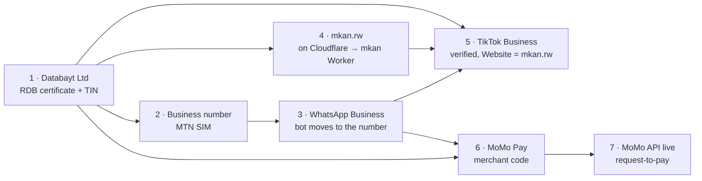

# Mkan Business Setup

TikTok is Mkan's front door: people find a home in a video, then write to Mkan on WhatsApp, and
Mkan earns 10% of the broker's commission when the lease is signed. Seven steps turn that into a
business people can **find**, **message** and **pay**:

1. **Databayt Ltd** registered at RDB: the company everything else is verified against.
2. **A business phone number** on MTN.
3. **WhatsApp** on that number: the bot, and the link people tap.
4. **mkan.rw**: Mkan's own address, the one the TikTok link points at.
5. **@mkan.rw as a verified TikTok Business page**, with the Website link.
6. **MoMo Pay**: a merchant code brokers pay Mkan's share to.
7. **The MoMo API**: Mkan asks for the money in one tap, and the payment closes the deal by itself.

Abdout's decisions (2026-11-07):
- The existing **@mkan.rw** becomes the Business page, keeping its followers and videos.
- The country in TikTok's list is **Rwanda**.
- The new number becomes **Mkan's whole business line**: the WhatsApp bot, the TikTok contact and MoMo. The current
  0780 984 777 goes back to personal.

> **Status lives on /monetize.** The admin view of [mkan.sd/en/monetize](https://www.mkan.sd/en/monetize)
> has a *Setup* checklist with these steps. Ticking a step done tells the sprint loop, which then does
> the code work that step unlocks (see [The loop](#the-loop-after-each-step)).

## The order

The company comes first because every other step asks for it:
- the business SIM
- TikTok's business verification
- MoMo's merchant registration
- MoMo's API go-live

The domain and the number can be bought in parallel once the company exists. TikTok's Website link needs the domain;
the MoMo merchant code needs the number.

## 1 · Databayt Ltd at RDB

| | |
|---|---|
| **Where** | [urs.rdb.rw](https://urs.rdb.rw) (the RDB online registration) |
| **State** | Draft **REG-2026-383583** is filled in. One choice is left: the registered office (your residence now, or the Norrsken virtual office first). The packet is private, in `kun/jobs/packets/rdb/`; tracked in databayt/kun#167. |
| **You get** | The company code and the **TIN**. RDB and RRA are integrated, so one TIN comes with the registration ([RRA](https://www.rra.gov.rw/en/details?tx_news_pi1%5Baction%5D=detail&tx_news_pi1%5Bcontroller%5D=News&tx_news_pi1%5Bnews%5D=2172&cHash=f71b51506099ed5a5ee43a7c3d80d1d5)). |
| **Cost / time** | The RRA says online registration is free and immediate. Guides quote from a few hours to two days, and one cites RWF 40,000 for a domestic company (unverified: check on the portal). |
| **Done when** | The certificate PDF and the TIN are saved in the private packet. Tick **Company registered** on /monetize. |
| **Unlocks** | Every step below. |

## 2 · A business phone number

| | |
|---|---|
| **What** | An **MTN Rwanda** SIM, because MoMo Pay is MTN's (Airtel Money is the alternative and needs its own merchant registration). |
| **Where** | Any MTN service centre. A SIM is registered to an ID; a business line can be registered to Databayt Ltd once the RDB certificate exists. |
| **Done when** | The number is active in a phone you keep for Mkan. Tick **Business number**. |
| **Next** | Save it as `MKAN_KIGALI_WHATSAPP` in the mkan `.env` (not a secret). The loop reads it from there. |

## 3 · WhatsApp on the new number

**First, the WhatsApp Business app** on the new phone:
- name **Mkan**, category *Real estate*
- description "Homes for rent in Kigali: send the code from our TikTok video"
- website `https://mkan.rw`, hours 08:00–20:00

**Then the bot moves to it.** Mkan's chat agent answers WhatsApp through the Evolution bridge. Pairing a number is
**your step**: run `pnpm wa:pair` in a session and scan the QR code with the new phone. The loop never pairs a number.

**What the loop changes once you tick WhatsApp on the new number:**
- `MKAN_WA_NUMBER` in `src/components/agent/wa-link.ts`. Every "Continue on WhatsApp" link uses it.
- The caption and end-card number (`MKAN_KIGALI_WHATSAPP`, read by `scripts/crm/tiktok-post.ts`).
- The broker messages that name Mkan's line.
- A "Mkan has moved to +250 …" auto-reply on the old number for 30 days.

**Later, not now:** Meta's WhatsApp Cloud API with *coexistence*. It keeps the Business app and the API on one
number, but it is charged per conversation and drops broadcast lists
([Meta](https://developers.secure.facebook.com/blog/post/2025/03/19/introducing-api-solutions-for-whatsapp-business-users-launched/),
[Chakra](https://chakrahq.com/article/whatsapp-coexistence-business-app-register-cloud-api/)). Rwanda's
eligibility was not confirmed.

## 4 · mkan.rw

| | |
|---|---|
| **Who sells it** | RICTA runs .rw but doesn't sell to the public; accredited registrars do. Anyone, anywhere can register a plain .rw name ([Irembo FAQ](https://support.new.irembo.gov.rw/en/support/solutions/articles/47001270673-faqs-about-rw-domain-registration-)). Second-level names (.co.rw) have their own rules; we want plain **mkan.rw**. |
| **Price** | Retail varies widely: [Dynadot](https://www.dynadot.com/domain/rw) lists $216 a year, [Asia Register](https://www.asiaregister.com/en/domains/tlds/rw) $650. Compare a Rwandan registrar before buying. |
| **DNS** | Add **mkan.rw** as a zone in Cloudflare (Databayt's account) and set the registrar's nameservers to the two Cloudflare gives. The shell's Cloudflare token cannot write DNS, so this is a dashboard step. |
| **Done when** | `dig NS mkan.rw` shows Cloudflare. Tick **mkan.rw on Cloudflare**. |
| **Next** | The loop prepares the mkan Worker's custom-domain route and the page mkan.rw opens on (the TikTok bio page, below). `wrangler.jsonc` is a held path, so the deploy happens in a session: say "deploy mkan". |

**What mkan.rw shows.** The TikTok bio link opens the homes from our videos:
- today's posts, each with its code and an **Ask on WhatsApp** button that opens the chat with that code;
- one general WhatsApp button.

Chats that start there are tagged *TikTok bio*, so the scorecard counts the link's conversions apart from the
captions'. Until mkan.rw is live, the same page is at **mkan.sd/en/tt**.

## 5 · @mkan.rw as a TikTok Business page

In the TikTok app, on the account that owns @mkan.rw:

1. **Switch to Business:** Profile → ☰ → Settings and privacy → Account → *Switch to Business
   Account*. Choose a real-estate category. It is free and keeps the followers and videos.
2. **Contact details:** the new number and `hi@databayt.org`.
3. **Business Center:** at [business.tiktok.com](https://business.tiktok.com), create Databayt's
   Business Center with country **Rwanda**.
   - The country decides which ad features and locations you get
     ([TikTok](https://ads.tiktok.com/help/article/placements-available-locations?lang=en)).
   - **If Rwanda is not in the list, stop and say so.** Don't pick a country whose documents we can't provide.
4. **Verify the business** with the RDB certificate
   ([how](https://ads.tiktok.com/help/article/about-business-verification?lang=en),
   [documents](https://ads.tiktok.com/resources/help/article/acceptable-documents-for-business-verification)).
   - The company name must match the certificate exactly; a mismatch is refused.
   - Review takes up to three business days; a refused verification can be appealed.
   - A verified Business Center passes its status to the TikTok accounts linked to it.
5. **Website = `https://mkan.rw`** under Edit profile. The link only works in the Website field: a URL typed in the
   bio text is never clickable.

**If the Website field isn't there yet.** Creator reports and some vendor guides say the clickable link needs 1,000
followers ([TikTok](https://www.tiktok.com/discover/how-many-followers-do-you-need-to-post-links),
[Trengo](https://trengo.com/blog/how-to-add-whatsapp-link-to-tiktok)). Another says the minimum was dropped in 2024
([UniLink](https://unil.ink/blog/tiktok-link-in-bio-requirements-2026)). No official page settles it. Until the field
shows:
- **bio text:** "📲 WhatsApp +250 … · send the code from the video";
- **every video:** the code and number in the caption and on the end card (already the case);
- **a pinned comment on each video:** "WhatsApp +250 … and send K6041".

**Done when:** tick **TikTok Business** once switched and verified, and **Website link** once mkan.rw opens from the
profile.

## 6 · MoMo Pay: a merchant code

| | |
|---|---|
| **Where** | An MTN business centre. |
| **Bring** | The RDB certificate, the TIN, the legal representative's ID, and proof of the business location (a lease) ([Kisimenti](https://kisimenti.com/en/times/rwanda-mobile-money-for-business-2026)). Third-party list: confirm at the centre. |
| **Time** | 1–5 business days, per one guide. |
| **You get** | A merchant code: brokers pay Mkan's share to it. |
| **Store it** | `security add-generic-password -a "$USER" -s cf-mkan-MKAN_PAYOUT_MOMO -U -w` (paste the code when asked), and `cf-mkan-MKAN_PAYOUT_NAME` = "Databayt Ltd". The next deploy puts "Pay with MoMo …" in every share request. |
| **Done when** | Tick **MoMo Pay**. |

## 7 · The MoMo API (production)

**Where it starts:** the sandbox is already set up. The identity is `databayt-primary` at
[momodeveloper.mtn.com](https://momodeveloper.mtn.com), and the food repo runs Collections with its
"#" workaround (MTN's firewall silently refuses a `#` in payment notes).

**Going live in Rwanda**, at [momodeveloper.mtn.co.rw/go-live](https://momodeveloper.mtn.co.rw/go-live):
1. Sandbox tests first.
2. Contracting: the business details, entity type, and that we are based in Rwanda.
3. KYC with the RDB certificate and TIN.
4. A live wallet and production keys.

The country's document list is on the Go Live page. Support is `mmitsupport.RW@mtn.com`. Store the production keys in
the Keychain as `cf-mkan-MOMO_SUBSCRIPTION_KEY`, `cf-mkan-MOMO_API_USER` and `cf-mkan-MOMO_API_KEY`, then tick
**MoMo API live**.

**What it opens up:**

| Use | How |
|---|---|
| **Broker share, closed by itself** | "Send share request" on /monetize becomes a MoMo *request to pay* to the broker's phone. They approve it on their phone, and the callback marks the deal PAID and records the money. No chasing, no "mark paid". |
| **Broker subscriptions** (roadmap S6) | A monthly request to pay for zone-matched leads, with receipts. |
| **Agency licence** (S7) | Monthly billing for agencies running the Mkan agent on their own listings. |
| **Tenant deposits** (optional) | A booking deposit when a viewing is in demand. Viewings are free today. |
| **A Databayt service** | MoMo integration for Kigali businesses (food already uses Collections): a revenue line of its own. |
| **Paying out, later** | Disbursements (refunds, referral rewards) is a separate MTN product to apply for when needed. |

## Costs

| Item | Cost | Note |
|---|---|---|
| Databayt Ltd | Free to RWF 40,000 | Sources disagree. The Norrsken virtual office is extra, if chosen. |
| MTN SIM | A few hundred RWF | Plus airtime and data. |
| mkan.rw | ~$216–650 a year | Registrar retail. Compare. |
| TikTok Business, verification | Free | Ads are separate. |
| MoMo merchant code | Free to register | MTN takes a fee per transaction. |
| MoMo API | Sandbox free | MTN earns on live transactions. |

## The loop after each step

The sprint loop works on Mkan around the clock (see [Sprint](/docs/sprint)). Each step above is a road task that
**waits for you without spending a session**: it sits blocked until you tick the step on /monetize, then it resumes and
does the code work that step unlocks.

| You tick | The loop then |
|---|---|
| — (now) | Builds the TikTok bio page (mkan.sd/en/tt, later mkan.rw), with chats tagged *TikTok bio*. |
| Company registered | Puts "Mkan is a product of Databayt Ltd · TIN …" in the site footer and the video end card's trust line. |
| WhatsApp on the new number | Moves the number in code, captions, end cards and broker messages; readies the "we moved" auto-reply. The re-pair is yours. |
| mkan.rw on Cloudflare | Prepares the Worker route and the mkan.rw home page, then asks you once to deploy in a session. |
| Website link | Reads the bio link and profile visits into the TikTok numbers; updates the playbook. |
| MoMo Pay | The share request carries the pay line; the warning on /monetize goes. |
| — (now) | Builds MoMo request-to-pay in the sandbox: one tap asks the broker, and the payment closes the deal. |
| MoMo API live | Switches to the production keys; one 100 RWF request to your phone proves it end to end. |

What the loop never does:
- pay or move money
- pair a WhatsApp number
- register anything in your name
- post on TikTok by hand

## Sources (read 2026-11-07)

- RDB and RRA: [How to register a business and get a TIN (RRA)](https://www.rra.gov.rw/en/details?tx_news_pi1%5Baction%5D=detail&tx_news_pi1%5Bcontroller%5D=News&tx_news_pi1%5Bnews%5D=2172&cHash=f71b51506099ed5a5ee43a7c3d80d1d5) · [Business registration with RDB (Kisimenti)](https://kisimenti.com/en/times/business-registration-rdb-online)
- .rw: [FAQs about .rw registration (Irembo)](https://support.new.irembo.gov.rw/en/support/solutions/articles/47001270673-faqs-about-rw-domain-registration-) · [Dynadot .rw](https://www.dynadot.com/domain/rw) · [Asia Register .rw](https://www.asiaregister.com/en/domains/tlds/rw)
- TikTok: [About business verification](https://ads.tiktok.com/help/article/about-business-verification?lang=en) · [Documents for business verification](https://ads.tiktok.com/resources/help/article/acceptable-documents-for-business-verification) · [Placements and available locations](https://ads.tiktok.com/help/article/placements-available-locations?lang=en) · [Followers needed for links (TikTok)](https://www.tiktok.com/discover/how-many-followers-do-you-need-to-post-links) · [WhatsApp link on TikTok (Trengo)](https://trengo.com/blog/how-to-add-whatsapp-link-to-tiktok) · [Link-in-bio requirements 2026 (UniLink)](https://unil.ink/blog/tiktok-link-in-bio-requirements-2026) · [Instant Messaging Ads (TikTok)](https://ads.tiktok.com/help/article/how-to-set-up-tiktok-instant-messaging-ads?lang=en)
- WhatsApp: [API solutions for WhatsApp Business users (Meta)](https://developers.secure.facebook.com/blog/post/2025/03/19/introducing-api-solutions-for-whatsapp-business-users-launched/) · [Coexistence (Chakra)](https://chakrahq.com/article/whatsapp-coexistence-business-app-register-cloud-api/)
- MoMo: [Go Live (MTN MoMo Developer Rwanda)](https://momodeveloper.mtn.co.rw/go-live) · [Mobile Money for business in Rwanda, 2026 (Kisimenti)](https://kisimenti.com/en/times/rwanda-mobile-money-for-business-2026) · [What are the requirements for going live? (MoMo community)](https://momodevelopercommunity.mtn.com/momo-api-production-q-a-7/what-are-the-requirements-for-going-live-238)

Figures from third-party guides (fees, times, the 1,000-follower rule) are marked as such: check
them where you do the step.
