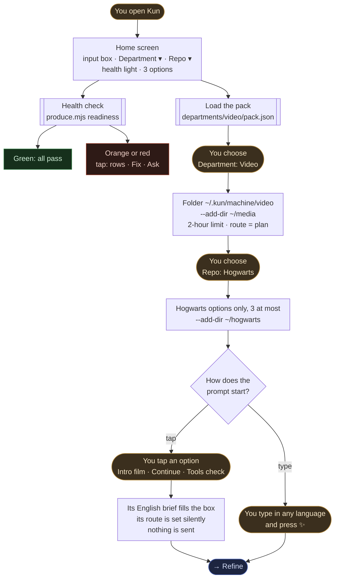
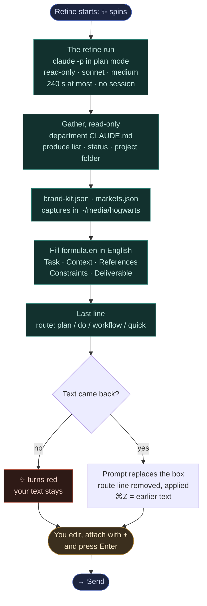
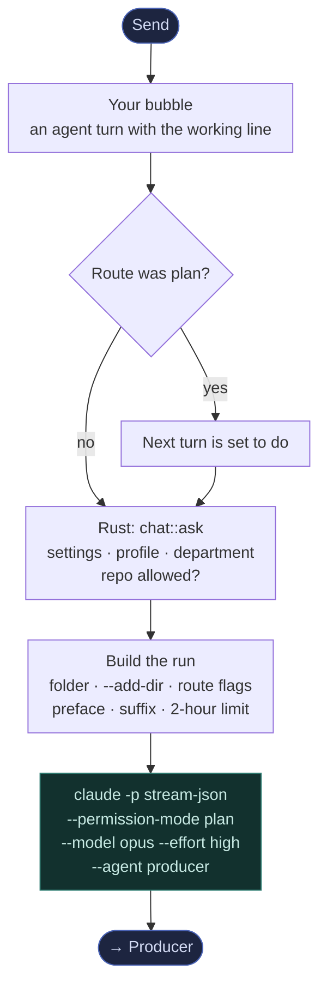
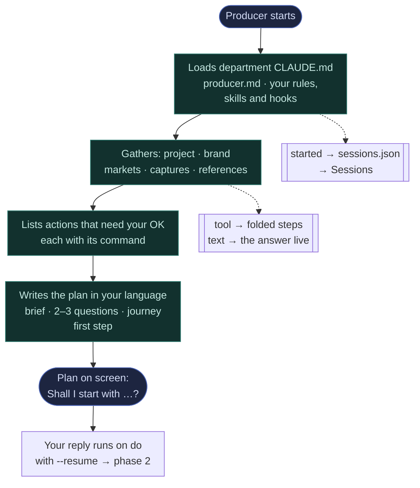

## Phase 1 — the flow

From opening Kun to the producer's first plan, in four parts. Gold is what you do, teal is a Claude
run, red is a failure path, blue hands over to the next part.

### 1 · Open and choose



### 2 · Refine: the prompt is written



### 3 · Send: the run is built



### 4 · The producer's plan turn: nothing is written



---

A film on the databayt video line is made in the **Kun desktop app** ([Machine](/docs/machine)).
The terminal does not render it. The app drives [produce](/docs/produce), the ledger that keeps
the 14 stages and the human gates.

This page explains the pipeline one phase at a time. **Phase 1** is written; later phases are added
as they settle.

| Phase | From | To |
| --- | --- | --- |
| **1 · The front door** | You open Kun | The producer's first plan is on screen |
| 2 · Pre-production | You answer the plan | The script gate |
| 3 · Production | Script approved | The version gate |
| 4 · Delivery | Version approved | CDN and publish |

---

## Phase 1 — the front door

**This phase succeeds when two things exist:**

- **A professional prompt.** It is always in English, follows one fixed formula, and carries every
  reference: absolute paths, CDN URLs, project ID, stage and gate, price, currency, dialect and
  length.
- **A decision on where it runs.** That means the agent, the model, the effort and the permission
  mode. The app makes this choice silently: you never see a selector.

### Step 0 — You open Kun

You land on the home screen. It shows:

- a greeting,
- the input box,
- under the box, the **context line**: Department ▾ · Repo ▾ · a health light,
- under that, **three options**. Each has an icon and a label, and a ✕ appears on hover to clear
  the box.

The app does two things in the background:

| What | How | Source |
| --- | --- | --- |
| Loads the department's pack | `packInfo(department, repo)` reads the pack file and returns its options, routes and prompt formula | `kun/departments/video/pack.json` |
| Checks the department's health | Runs `node ~/.claude/skills/produce/scripts/produce.mjs readiness --json` without a shell, 120 s at most. The result sets the light: green when every check passes, orange on a warning, red on a critical failure. | `pack.json → health.check` |

If the light is not green, you can tap it to see the failing rows and run the fix
(`readiness --fix`, up to 15 min). You can also ask the agent about a row; that question runs on the
"do" route.

### Step 1 — Choose the department (Video)

The pack loads again for the new department, and the route choice goes back to that department's
default. The department sets three things:

- **The working folder.** Every run starts in `~/.kun/machine/video/`. That folder's `CLAUDE.md` is
  the department's rules (Arabic first, `media-qa` before anything is published, no real student
  data, never the real camera, …). Its `.claude/agents` and `.claude/skills` are links into kun.
- **The extra folders.** `pack.json → dirs` is `["~/media"]`, so every run can reach the media
  library.
- **The run limit.** `timeoutSecs` is 7,200 s, so one turn may run for up to 2 hours.

### Step 2 — Choose the repo (Hogwarts)

The repo decides two things:

- **Which options you see.** An option that lists `repos: ["hogwarts"]` appears only for Hogwarts.
  Without a repo, you see the general options instead ("Reel from a video", "Video script"). There
  are never more than three.
- **What the run can read.** `/Users/abdout/hogwarts` joins the run as `--add-dir`. A new chat also
  opens with the line *"Working in hogwarts for the video department."*

The Hogwarts options:

| Option | Silent route | What its brief asks |
| --- | --- | --- |
| **Intro film** | `plan` | Plan an intro film for Hogwarts (the viewer sees the brand Balqalam). Sudan · Arabic · Facebook 9:16 · about 2:00 |
| **Continue production** | `do` | Pick up the open project at its current stage |
| **Tools check** | `quick` | Check that the production tools are ready |

### Step 3 — Tap an option

**A tap fills the box. It never sends.** Three things happen at once:

1. The option's short English brief appears in the box, with the caret at the end.
2. The option's route is chosen silently (Intro film → `plan`).
3. **Refine starts on its own.** The ✨ button turns into a spinner. Step 4 covers what it does.

You can also type your own request in any language and press ✨ yourself. It is the same run.

### Step 4 — Refine: the AI that loads while the prompt is written

This is the spinner you see while the prompt is being built. It is a **separate, short Claude run**
that turns a rough request into the professional prompt. It has nothing to do with your chat.

**How it runs**

| Setting | Value | Why |
| --- | --- | --- |
| Program | `claude -p --output-format stream-json --verbose` | The same Claude Code as the chat, signed in with your own account |
| Permission mode | `plan` (read-only) | It may read files and run status commands, but it cannot write, render or create a project |
| Model · effort | `sonnet` · `medium` | Rewriting is cheap work. Opus is kept for the producer |
| Agent | none | Refine is not the producer; it only writes the prompt |
| Folder | `~/.kun/machine/video/`, plus `--add-dir` for the repo and `~/media` | It sees exactly what the real run will see |
| Time limit | 240 s | It gathers before it writes. A typical run takes 45 s to 2 min |
| Session | none kept | It does not appear in Sessions |

**What it is told**, in this order:

1. Rewrite the request as one professional prompt, **in English whatever language it was typed in**.
2. **Gather first, read-only:**
   - the department's `CLAUDE.md`,
   - `produce.mjs list --json --repo hogwarts` and `status <ID>` for the matching project,
   - that project's folder (reference video, transcript, script, asset manifest),
   - `kun/content/media/brand-kit.json` (the identity),
   - `kun/content/media/markets.json` (price, currency, dialect),
   - existing captures under `~/media/hogwarts/`.
3. Put every fact the worker needs into the prompt, so that it stands alone: absolute paths, CDN
   URLs, project ID, stage and gate, price, currency, dialect and length. **Do not start the work.**
4. Fill the **formula** exactly: the same headings in the same order, with "none" where nothing
   applies.
5. End with one last line, `route: <id>`, choosing one of `plan`, `do`, `workflow` or `quick`.

**The formula** is stored in `pack.json → formula.en`, so you can change it there without a new app
build:

```markdown
## Task
<one line: the deliverable · for whom · which version · the goal>

## Context
- Repo / brand: <repo> / <brand the viewer sees>
- Project: <project ID> · stage: <current stage> · next gate: <gate>
- Audience: <who>
- Version: <market> · <language> · <dialect>
- Price: <amount> <currency> per student per month
- Destination: <platform> · <aspect> · <device> · <length>

## References
- <absolute path or CDN URL> — <what it is>

## Constraints
- Claims only from real captures; generated scenes are illustrative.
- No real student or parent data; brand name as the viewer sees it.
- Stop at every human gate (script · look/animatic · version · publish); never approve.

## Deliverable
<plan mode: the brief in one line · 3 questions with recommended answers · the journey · the first step>
<work mode: the stage's output by absolute path, `produce advance`, stop at the gate>
```

**When it finishes**

- The box text is **replaced** by the finished prompt.
- The app reads the `route:` line, **removes it from the text** and chooses that route silently.
  This is why refine can move "Intro film" from `plan` to `do`: it found that the project already
  exists. An id that is not in the pack is ignored.
- A code fence around the answer is removed.
- **⌘Z** brings back the text you had before, as long as you have not edited the result.
- **If it fails** (time limit, no answer), the ✨ turns red and your text stays as it was. You can
  send it unrefined or press ✨ again.

In a real test on «فيديو تعريفي لهوغورتس السودان عربي», refine returned the full formula in English
with about 25 references:

- the project ID and its stage (visual),
- the Sudan script and every iPhone capture by scene,
- the brand colours and the Sudan price ($6.40),
- the CDN URL the film will have (`https://cdn.databayt.org/video/hogwarts/intro/sd-ar/fb-9x16.mp4`).

It also raised the open questions it found (price wording, an empty music folder).

### Step 5 — Edit, attach, send

- Change the prompt as much as you like. It is just text now.
- **+ → Attach** adds files. Each file becomes a line under References (an absolute path, or a CDN
  URL for a media file).
- **Enter**, or the send button, sends it.

### Step 6 — What happens right after Send

**In the window**

1. Your prompt appears as your bubble, and an empty agent turn opens with an orange working line.
2. If the route was `plan`, the app switches the *next* turn to `do`, so your answer to the plan
   carries out the work.

**In the app's Rust side** (`chat::ask`):

1. It reads your settings and profile, works out the department, and checks that the repo is allowed.
2. It builds the run:
   - the folder `~/.kun/machine/video/`,
   - `--add-dir /Users/abdout/hogwarts` and `--add-dir ~/media`,
   - the route's flags,
   - the 2-hour limit.
3. It adds the opening line *"Working in hogwarts for the video department."* (new chats only), plus
   the route's suffix if it has one.
4. It starts Claude Code with no shell. For the `plan` route the command is:

```bash
claude -p --output-format stream-json --verbose --permission-mode plan \
  --add-dir /Users/abdout/hogwarts --add-dir /Users/abdout/media \
  --model opus --effort high --agent producer \
  -- "Working in hogwarts for the video department.

## Task
…the refined prompt…"
```

**The four routes.** They are defined in `pack.json → routes` and never shown in the app.

| Route | Mode | Agent · model · effort | Used for |
| --- | --- | --- | --- |
| `plan` (default) | plan, read-only | producer · opus · high | A new film: gather, ask, propose the journey |
| `do` | auto | producer · opus · medium | Work one stage, then stop at the gate. Also every reply to a plan |
| `workflow` | auto | producer · opus · high | Many versions at once. Its suffix asks for a workflow: one Sonnet agent per version, each one verified, never Fable |
| `quick` | auto | sonnet · low, no agent | Status, checks, lookups |

**Inside Claude Code**, the run loads:

- the department's `CLAUDE.md`,
- the **producer** agent (`.claude/agents/producer.md`),
- your user-level rules, skills and hooks.

The producer is the only role that talks to you. Any building it hands off goes to Sonnet
sub-agents.

**The stream back.** Claude prints one JSON line per event, and the app turns each into something on
screen:

| Event | On screen |
| --- | --- |
| `started` (session id) | The chat is saved in `~/.kun/machine/sessions.json`, titled with the first 60 characters, so it appears in **Sessions** |
| `tool` | One folded step per tool ("Reading…", "Running…") |
| `text` | The answer, as it arrives |
| `done` | The final text. If "read replies aloud" is on, it is spoken |
| `error` | A red line with **Retry** |

**What the producer does on a plan turn** (it writes nothing):

1. **Gathers** the produce project, the brand kit, the markets, the captures, any reference
   transcript and the product docs, then says in one line what it read.
2. **Lists the actions that need your OK**, each with its exact command: pulling a WhatsApp
   reference, transcribing, creating the project.
3. **Writes the plan**, in your language:
   - the brief in one line,
   - 2 or 3 questions that change the film, each with a recommended answer,
   - the journey (stage → tool → lane → gate → what is reused),
   - the first step, ending with *"Shall I start with …?"*

### Phase 1 ends here

The plan is on screen, nothing has been written, and the next turn is set to `do`. Your answer to
the plan, on the same session (`--resume`), opens phase 2.

### Who is involved

| Part | Role in phase 1 | Where it lives |
| --- | --- | --- |
| Kun app (UI) | Home, options, ✨, silent route, the stream on screen | `~/machine/src/components/chat/` |
| Kun app (Rust) | `ask` and `refine` commands; builds and starts each run | `~/machine/src/components/chat/rust.rs` |
| Video pack | Options, routes, formula, folders, health check, time limit | `kun/departments/video/pack.json` |
| Department folder | Where every run starts; its rules | `~/.kun/machine/video/` (from `departments/video/prompt.md`) |
| Claude Code | Runs refine and the turn on your own subscription | `claude` on your computer |
| Producer agent | Plans, asks, routes; never approves | `kun/.claude/agents/producer.md` |
| produce ledger | Projects, stages, gates; `readiness` for the light | `~/.claude/skills/produce/scripts/produce.mjs` |
| Brand and markets | Identity, price, currency, dialect | `kun/content/media/brand-kit.json`, `markets.json` |
| Media library | Captures, projects, deliverables | `~/media/`, `~/media/_projects/<ID>/` |

### Rules in this phase

- **The prompt is always English**, in the one formula. The agent still answers you in your language.
- **Routing is silent.** There is no selector or label in the app; to change a route, edit `pack.json`.
- **The options stay a flat list of three**, with a ✕ to clear. There is no accordion and no
  drill-down.
- **Fable is never used** in refine, a route or a sub-agent. The pack rejects it.
- **Nothing is written before a plan is answered.** Refine and the `plan` route are both read-only.
