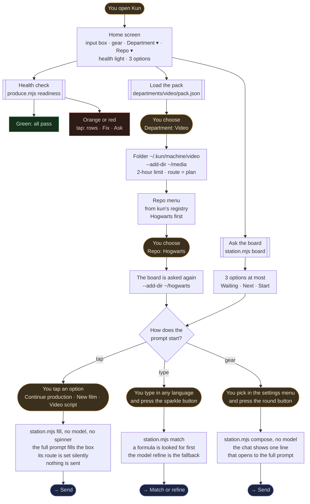
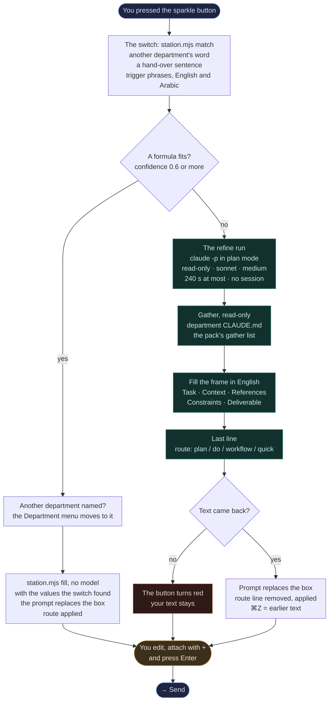
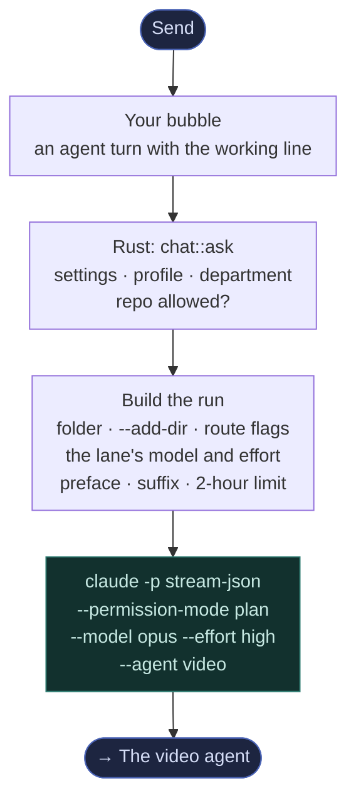
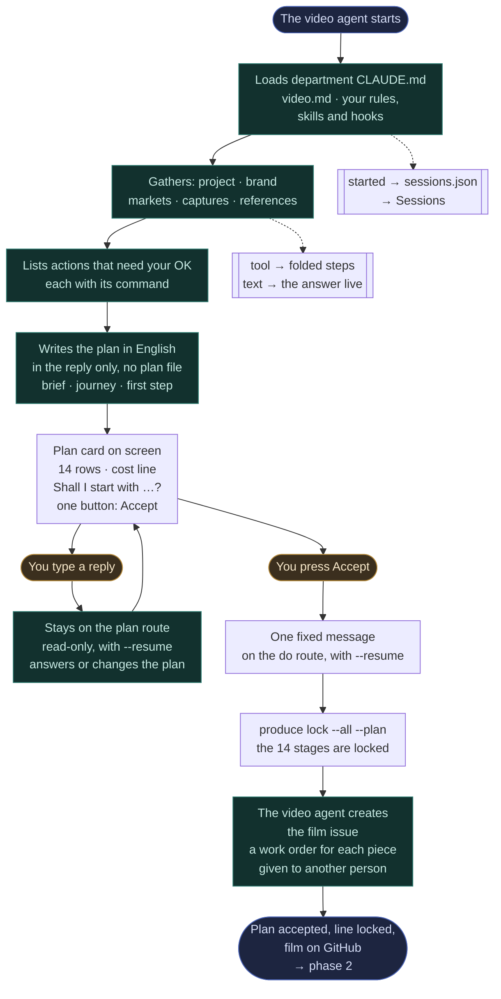
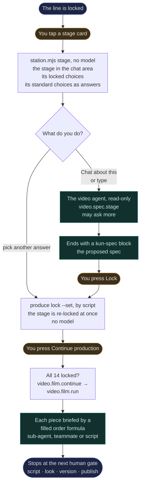

## Phase 1 — the flow

From opening Kun to an accepted, locked plan, in four parts. Gold is what you do, teal is a Claude run, red
is a failure path, blue hands over to the next part. The design behind the options and the prompts
is on the [Station](/docs/station) page.

### 1 · Open and choose



#### What happens in part 1, box by box

**You open Kun.** You open the app the way you open any app on your Mac. You type nothing. The app
starts on its home screen.

**The home screen.** You see five things:

- **A greeting** in the middle of the screen.
- **The input box**, the large box where your request goes. It is empty.
- **Department ▾**, a small menu under the box. It names the team you are working for, such as
  Video or Sales.
- **Repo ▾**, a second menu beside it. It names the product the work is about, such as Hogwarts.
- **The health light**, a small coloured dot. It tells you whether the tools on this computer are
  ready.

Under them there are **three options**, short rows with an icon and a name. When you hover over
one, a small ✕ appears at the end of its row. The ✕ takes that option off the list for this visit.

As soon as the home screen opens, the app does three jobs without asking you. They are the three
boxes with a double border in the chart.

**Load the pack.** Every department has a settings file in kun called its *pack*. For Video it is
`departments/video/pack.json`. The app reads it to learn three things:

- **the routes**: the ways a request can be run (plan first, do it now, workflow, quick),
- **the frame**: the five fixed headings every finished prompt uses,
- **the fallback options**: a short list shown only when the board cannot answer.

You never see this file. To change a route or the frame, you change this file; the app does not
need a new version.

**Health check.** At the same time, the app checks that the video tools on this computer work. It
runs one command, `produce.mjs readiness`, which tests 14 things: ffmpeg, Blender, FilmCraft,
the speech-to-text model, the recording browsers, free disk space, mains power, the Kun app itself,
the Blender and FilmCraft connections, and the Gemini key. The check may take up to two minutes. Its answer sets the colour of the
light:

- **Green: all pass.** Everything is ready, and you can carry on.
- **Orange or red.** Orange means something is missing but the work can still go on. Red means
  something important is broken. Tap the light to see the list of checks, each with its result.
  **Fix** tries to repair what it can by itself (it may take up to 15 minutes). **Ask** sends the
  problem to the agent, which works on it.

You can choose your department and repo while the check is still running; nothing waits for it.

**Ask the board.** The three options are chosen by a script, `station.mjs board`. The department
keeps its prompts written in advance, one file each, in `departments/video/formulas/`. Each one is
called a *formula*. The script reads them, looks at the state of the work (an open film, an approval
that waits, a work order made for you), gives each formula a score, and returns three at most.
There is one place for each role:

- **Waiting**: something waits for you. It is either one of a film's four approvals (script, look,
  version, publish) or a work order made for you.
- **Next**: the next step of work that is already open.
- **Start**: something new.

No model runs for this, and the answer comes in a fraction of a second. If the board cannot answer,
the home shows the pack's fallback options instead, so it is never empty for that reason.

**You choose Department: Video.** Open the Department menu and pick **Video**. The app reads the
Video pack again, asks the board again, and resets the choice of how to run your request to the
safe default, *plan first*. Three things are now settled for every run you start, even though
nothing is shown:

- **The working folder**: `~/.kun/machine/video`. This is the department's own room. Its
  `CLAUDE.md` holds the video team's rules: Arabic first, nothing is published without a check and
  a person's yes, no real faces or names of students, never the real camera.
- **The media library**: `~/media` is opened to the agent too (`--add-dir ~/media`), so it can see
  earlier captures, projects and finished films.
- **The time limit**: one answer may work for up to **2 hours**, because video work is slow.

**The Repo menu.** The list in this menu is not built into the app. It comes from kun's registry of
repos, the file `.claude/memory/repositories.json`. The menu shows the repos that your department's
pack and your own profile name, keeps only the ones the registry marks as active, and puts Hogwarts
first. A repo that has a word of its own in the registry is shown by that word: the databayt.org
site repo is called `marketing` on GitHub and appears as `landing`.

**You choose Repo: Hogwarts.** Open the Repo menu and pick **Hogwarts**. This does two things:

- **The board is asked again**, this time for Hogwarts, so it looks at the Hogwarts films.
- **It opens the product's code to the agent.** The Hogwarts folder (`--add-dir ~/hogwarts`) is
  added, so the agent can read the real product to check what the film claims. A new chat also
  starts with one hidden line: *"Working in hogwarts for the video department."*

The app remembers your choices, so next time Kun opens on Video and Hogwarts already.

**The three options today.** With a Hogwarts film in production, the board shows:

| Option | Role | Use it when | How it will run |
| --- | --- | --- | --- |
| **Continue production** | Next | A film is already under way and you want the next step | Do it now: one stage, then it stops at the next approval |
| **New film** | Start | You want to plan another film | Plan first: the agent asks before it does anything |
| **Video script** | Start | You want a script only | Do it now |

There is no Waiting option today, because no approval is waiting and no work order has been made
for you. When a role has nothing to offer, the board fills the empty place with the next best
option, which is why there are two Start options. **New film** is the same formula as *Intro film*.
It takes that name while a film is open, so that it does not look like a second way to continue.

**How does the prompt start?** Now there are two ways to begin.

- **Tap an option.** The full prompt fills the box at once. The same script, run as
  `station.mjs fill`, takes the option's formula and fills its blanks from files and from the state
  of the work: the
  brand from the repo, the price and currency from the markets file, today's date, the open film
  and its stage. No model runs and there is no spinner. Tapping does not send anything. At the same
  moment the app quietly notes how the request should run (plan first, for New film). You see no
  label for this; it happens in the background.

  For New film the box now holds a complete request: plan a new intro film for Hogwarts (viewers see
  the brand Balqalam), for school owners and principals, the Sudan version in Arabic, for Facebook,
  vertical, about two minutes. For Continue production the script looks at the stage the open film
  has reached and fills the prompt for that stage.

- **Type your own.** Write what you want in the box in any language, Arabic or English, as roughly
  as you like, then press the **sparkle button** beside the microphone.

**The sparkle button looks for a formula first.** The same script, run as `station.mjs match`, reads
your words and tries to find the formula they mean. It finds one in three ways:

| You type | What it finds | What fills the box |
| --- | --- | --- |
| Words that name a kind of work: "فيديو تعريفي لهوغورتس السودان" | The formula whose trigger phrases fit. Here it is the new film | The same prompt as a tap on New film |
| A hand-over sentence: "give the classroom scene to sedon" | The work order for that kind of piece. Here it is the Blender scene | The request for Sedon, with his name and the piece already written in |
| Words that name another department: "sales quote a school for 48 students" | That department's formula. Here it is Sales' quote | The app moves the Department menu to Sales without asking, and fills the quote |

When a formula is found, it is filled exactly as a tap fills it: by script, with no model. Whatever
the script cannot know stays visible in the box as `[unfilled: name]`; in the Sales example those
are the number of students and the school's record id.

**Only when no formula fits, the model refine runs.** Refine is a short, read-only Claude run that
rewrites your words into a full prompt. It is the one case in which the sparkle button turns into a
spinner for more than a moment. Part 2 shows both paths.

**Send, or match first.** A tapped option is already complete, so it skips part 2 and goes straight
to part 3. Typed text goes through part 2.

**At the end of part 1:** the department and repo are chosen, the tools have been checked, the box
holds a complete prompt (after a tap, or after the sparkle button) or your own words, and the app
knows where the request will run. Nothing has been sent and nothing on the computer has changed.

### 2 · Typed text: match first, refine only if nothing fits



### 3 · Send: the run is built



### 4 · The plan turn: nothing is written until you accept



---

A film on the databayt video line is made in the **Kun desktop app** ([Machine](/docs/machine)).
The terminal does not render it. The app drives [produce](/docs/produce), the ledger that keeps
the 14 stages and the human gates.

This page explains the pipeline one phase at a time. **Phases 1 and 2** are written; later phases
are added as they settle.

| Phase | From | To |
| --- | --- | --- |
| **1 · The front door** | You open Kun | The plan is accepted, the line is locked, and the film is on GitHub |
| **2 · The locked line** | The line is locked | The next human gate, then the next one |
| 3 · Production | Script approved | The version gate |
| 4 · Delivery | Version approved | CDN and publish |

---

## Phase 1 — the front door

**This phase succeeds when three things exist:**

- **A professional prompt.** It is always in English, uses the same five headings, and carries every
  reference the worker needs: the project ID, the stage and gate, the price, currency, dialect and
  length, and the links or paths to read.
- **A decision on where it runs.** That means the agent, the model, the effort and the permission
  mode. The app makes this choice silently: you never see a selector.
- **An accepted plan, locked and on GitHub.** All 14 stages are locked, one film issue tracks the
  film, and the first work orders exist. A *work order* is one request for one person with one
  deliverable, written as a GitHub issue.

Five words are used from here on. A *formula* is a prompt written in advance for one kind of work.
A *slot* is a blank in a formula that is filled when it is used. A *route* is one way of running a
request. A *gate* is a point where the work stops until a person says yes; a film has four: script,
look, version and publish. A *lock* is one stage's decisions written down and recorded in the
film's ledger; Phase 2 explains it. The [Station](/docs/station) page explains each of them in full.

### Step 0 — You open Kun

You land on the home screen. It shows:

- a greeting,
- the input box, with the **gear** inside it (see [The settings menu](#the-settings-menu)),
- under the box, the **context line**: Department ▾ · Repo ▾ · a health light,
- under that, **three options**. Each has an icon and a label, and a ✕ appears on hover to take that
  option off the list.

The app does three things in the background:

| What | How | Source |
| --- | --- | --- |
| Loads the department's pack | `packInfo(department)` reads the pack file and returns its routes, its frame and its fallback options | `kun/departments/video/pack.json` |
| Checks the department's health | Runs `node ~/.claude/skills/produce/scripts/produce.mjs readiness --json` without a shell, 120 s at most. The result sets the light: green when every check passes, orange on a warning, red on a critical failure. | `pack.json → health.check` |
| Asks the board | Runs `node <kun>/.claude/scripts/station.mjs board --dept video --repo hogwarts --login <you> --json` without a shell, 5 s at most, adding `--health` with the light's colour once it is known. An empty answer never blocks the home: the pack's `quickActions` show instead. | `kun/.claude/scripts/station.mjs`, `kun/departments/video/formulas/` |

If the light is not green, you can tap it to see the failing rows and run the fix
(`readiness --fix`, up to 15 min). You can also ask the agent about a row; that question runs on the
"do" route.

The board is asked again whenever the department, the repo or the colour of the health light
changes. When the light is red, the options that need the tools are left out and **Tools check**
takes the Start place.

### Step 1 — Choose the department (Video)

The pack loads again for the new department, the board is asked again, and the route choice goes
back to that department's default. The department sets three things:

- **The working folder.** Every run starts in `~/.kun/machine/video/`. That folder's `CLAUDE.md` is
  the department's rules (Arabic first, `media-qa` before anything is published, no real student
  data, never the real camera, …). Its `.claude/agents` and `.claude/skills` are links into kun.
- **The extra folders.** `pack.json → dirs` is `["~/media"]`, so every run can reach the media
  library.
- **The run limit.** `timeoutSecs` is 7,200 s, so one turn may run for up to 2 hours.

### Step 2 — Choose the repo (Hogwarts)

The Repo menu is built from kun's registry, `.claude/memory/repositories.json`. It lists the repos
that the department's pack and your profile name, limited to the ones the registry marks `active`,
with Hogwarts first. A repo with a `word` in the registry shows that word (`marketing` shows as
`landing`). The same list is checked again before every run, so a run can never name a repo that is
not on the menu.

The repo decides two things:

- **Which films the board looks at.** The board reads the open projects of that repo's production
  line (`produce.mjs list --json --repo hogwarts`). The repo also sets some defaults in a prompt:
  for Hogwarts the brand the viewer sees is Balqalam.
- **What the run can read.** `/Users/abdout/hogwarts` joins the run as `--add-dir`. A new chat also
  opens with the line *"Working in hogwarts for the video department."*

The three options the board returned for Video with Hogwarts on 2026-11-22:

| Option | Role | Formula | Silent route | Why the board chose it |
| --- | --- | --- | --- | --- |
| **Continue production** | Next | `video.film.continue` | `do` | `continue: open project hogwarts-intro-introduction-v001` · `drive 0.9` |
| **New film** | Start | `video.film.plan` | `plan` | `drive 1` |
| **Video script** | Start | `video.script.only` | `do` | `drive 0.5` |

How the scores are made, and what would put an option in the Waiting place, is in
[the board section of the Station page](/docs/station#the-board).

### Step 3 — Tap an option

**A tap fills the box. It never sends.** Three things happen at once:

1. The tap is noted in `~/.kun/machine/station-log.jsonl`. The board reads this log, so an option
   you pick often scores a little higher, and one you dismiss with ✕ scores a little lower.
2. The app runs `station.mjs fill <formula> --dept video --repo hogwarts --login <you> --json`
   (10 s at most), with the values the board attached to the option. The finished prompt appears in
   the box, with the caret at the end.
3. The formula's route is chosen silently. For New film that is `plan`.

The three home options are the only taps that fill the box. The gear starts a request another way;
see [The settings menu](#the-settings-menu).

**No model runs, and there is no spinner.** The script fills each slot from a file, from the state
of the work, or from a default. A slot it cannot fill stays visible in the box as
`[unfilled: name]`, so nothing is missing silently.

**Continue production follows the film.** Its formula hands over to the formula of the stage the
open film has reached. Today the film is at the visual stage, so the tap fills `video.stage.visual`.

**What New film writes.** This is the real prompt the tap puts in the box (your home folder is
written in full; it is shortened to `~` here):

```markdown
## Task
Plan a new intro film for Balqalam (hogwarts): the brief in one line, the questions that change the film, the journey and the first step. Plan only; change nothing.

## Context
- Repo / brand: hogwarts / Balqalam (the name the viewer sees)
- Audience: school owners and principals
- Goal: the viewer books the free first month
- Version: Sudan · Arabic · msa dialect
- Price: 6.4 USD per student per year
- Destination: Facebook · vertical 9:16, mobile · about 2:00
- Today: 2026-11-22. Project: none yet for this film type, unless `produce list` below shows one; if it does, say so and propose continuing it instead.

## References
- Open projects: run `node ~/.claude/skills/produce/scripts/produce.mjs list --json --repo hogwarts`, then `status <ID>` for any match. Read the project folder (reference video, transcript, script, asset manifest).
- Brand kit (identity): https://github.com/databayt/kun/blob/main/content/media/brand-kit.json
- Markets (price, currency, dialect): https://github.com/databayt/kun/blob/main/content/media/markets.json
- Real captures: look in ~/media/hogwarts/ before proposing any new capture.
- Reference film: the latest video the team approved in the WhatsApp group «المدرسة 2.0», raised to a cinematic level with 3D characters. A WhatsApp video is pulled with `wa-pull.py` and seeded with `produce from-reference <ID> <video>`; both are actions that need the person's yes first.

## Constraints
- Gather read-only first and say in one line what you read. Do not create a project, render, or call any tool that writes.
- List every action that needs the person's yes under "actions I need your OK for", each with its exact command.
- Answer the person in their own language; this prompt stays English.
- Claims only from real captures; generated scenes are illustrative.
- No real student or parent data; brand name as the viewer sees it.
- Stop at every human gate (script · look/animatic · version · publish); never approve.

## Deliverable
- The brief in one line: what · for whom · which version · the goal · the destination.
- Three questions that change the film, each with a recommended answer the person can accept with "yes".
- The journey as a numbered list: stage → tool → lane → gate → what is reused. Stages run request, research, brief, script, storyboard, assets, visual, audio, edit, render, qa, approval, cdn, publish; gates are script · look · version · publish.
- The first step and what it produces, ending with the question "Shall I start with …?".
```

The prompt comes from three places, each kept in one file:

| Layer | What it gives | Where |
| --- | --- | --- |
| The frame | The five headings, in this order | `pack.json → formula.en` |
| The department's constraints | The last three lines under Constraints, added to every Video prompt | `pack.json → constraints` |
| The formula | Everything else, with its slots filled | `departments/video/formulas/video.film.plan.md` |

The price is the list price **per student per year**, read from `kun/content/media/markets.json`.

### Step 4 — Typed text: match, then refine

You can also type your own request in any language and press the sparkle button. Two things can
happen, and the first is tried first.

**You usually don't need the button.** While you type, the composer asks the switch by itself after
a short pause (three words or more). When a formula fits, a chip appears above the box, such as
`⇥ Tab · Intro film · Balqalam · 9:16 · Facebook`. Press **Tab** and the formula is filled with the
values your sentence gave, the same as a tap; press **Esc** to dismiss it; press **Enter** to send
your words as they are. Typing `/` lists the formulas and skills to pick from. The steps below are
what the switch does in either case.

**First, the switch looks for a formula.** The app runs
`station.mjs match "<your text>" --dept video --repo hogwarts --json` (5 s at most). The script
answers with a formula, a confidence, and the values it could read out of your words. It looks in
this order:

1. **Another department's word.** If the text names another department and not your own, the text
   is matched against that department's formulas, and the answer names the department.
2. **A hand-over sentence.** "Give, hand, assign or send *a piece* to *a person*", or the same in
   Arabic (اعط، سلّم، كلّف … لـ or إلى). The words of the piece choose the work order (a scene is a
   Blender order, a script is a script order), and the answer carries the person and the piece.
3. **Trigger phrases.** Each formula lists phrases in English and Arabic; the longest one that
   appears in your text wins.

With a formula and a confidence of 0.6 or more, the app fills that formula exactly as a tap does,
handing over the values the switch found. If the answer names another department, the app first
moves the Department menu to it, without asking. No model runs.

Three real answers:

| Typed in Video | Formula | Confidence | Also returned |
| --- | --- | --- | --- |
| «فيديو تعريفي لهوغورتس السودان» | `video.film.plan` | 0.92 | nothing |
| "give the classroom scene to sedon" | `video.order.blender` | 0.92 | `to: sedon`, `scene: the classroom scene` |
| "sales quote a school for 48 students" | `sales.quote.school` | 0.99 | the department, `sales` |

**Only when nothing fits, refine runs.** Refine is a **separate, short Claude run** that turns a
rough request into the professional prompt. While it works, the sparkle button turns into a spinner.
It has nothing to do with your chat.

**How it runs**

| Setting | Value | Why |
| --- | --- | --- |
| Program | `claude -p --output-format stream-json --verbose` | The same Claude Code as the chat, signed in with your own account |
| Permission mode | `plan` (read-only) | It may read files and run status commands, but it cannot write, render or create a project |
| Model · effort | `sonnet` · `medium` | Rewriting is cheap work. Opus is kept for the video agent |
| Agent | none | Refine is not the video agent; it only writes the prompt |
| Folder | `~/.kun/machine/video/`, plus `--add-dir` for the repo and `~/media` | It sees exactly what the real run will see |
| Time limit | 240 s | It gathers before it writes |
| Session | none kept | It does not appear in Sessions |

**What it is told**, in this order:

1. Rewrite the request as one professional prompt, **in English whatever language it was typed in**.
2. **Gather first, read-only:** the department's `CLAUDE.md`, then everything in the pack's own
   list, `pack.json → gather`. For Video that list is:
   - `produce.mjs list --json --repo hogwarts` and `status <ID>` of the matching project,
   - that project's folder (reference video, transcript, script, asset manifest),
   - `kun/content/media/brand-kit.json` and `markets.json` (price, currency, dialect),
   - existing captures.
3. Put every fact the worker needs into the prompt, so that it stands alone: absolute paths, CDN
   URLs, project ID, stage and gate, price, currency, dialect and length. **Do not start the work.**
4. Fill the **frame** exactly: the same headings in the same order, with "none" where nothing
   applies.
5. End with one last line, `route: <id>`, choosing one of `plan`, `do`, `workflow` or `quick`.

**The frame** is stored in `pack.json → formula.en`, so you can change it there without a new app
build:

```markdown
## Task
One line: the deliverable, for whom, which version, the goal.

## Context
The repo and brand, the project and its stage, the audience, the version (market, language, dialect), the price and currency, the destination.

## References
Every link or path the worker needs, each with what it is. A work order carries links only, never a local path.

## Constraints
What must hold: the department's rules (appended automatically) and anything specific to this piece.

## Deliverable
What comes back, where it goes and the gate it stops at. A plan turn returns the brief, the questions, the journey and the first step.
```

**When the sparkle button finishes**

- The box text is **replaced** by the finished prompt.
- After a refine run, the app reads the `route:` line, **removes it from the text** and chooses that
  route silently. An id that is not in the pack is ignored. After a match, the route is the
  formula's own.
- A code fence around a refined answer is removed.
- **⌘Z** brings back the text you had before, as long as you have not edited the result.
- **If refine fails** (time limit, no answer), the sparkle button turns red and your text stays as
  it was. You can send it as it is or press the button again.

**Send starts the chat.** A tap on a formula only fills the box; nothing asks locally. The plan run then
asks its own questions, which change from film to film (Step 6b).

### Step 5 — Edit, attach, send

- Change the prompt as much as you like. It is just text now.
- **Attach**, under the **+** button, adds files. Each file becomes a line under References (an
  absolute path, or a CDN URL for a media file).
- **Enter**, or the send button, sends it.

### Step 6 — What happens right after Send

**In the window**

Your prompt appears as your bubble, and an empty agent turn opens with an orange working line.

**In the app's Rust side** (`chat::ask`):

1. It reads your settings and profile, works out the department, and checks that the repo is allowed.
2. It builds the run:
   - the folder `~/.kun/machine/video/`,
   - `--add-dir /Users/abdout/hogwarts` and `--add-dir ~/media`,
   - the route's flags: the permission mode, the agent, and the model and effort of the route's lane,
   - the 2-hour limit.
3. It adds the opening line *"Working in hogwarts for the video department."* (new chats only), plus
   the route's suffix if it has one.
4. It starts Claude Code with no shell. For the `plan` route the command is:

```bash
claude -p --output-format stream-json --verbose --permission-mode plan \
  --add-dir /Users/abdout/hogwarts --add-dir /Users/abdout/media \
  --model opus --effort high --agent video \
  -- "Working in hogwarts for the video department.

## Task
…the filled prompt…"
```

### Step 6b — The run asks, you answer

Before it plans, the plan run asks the questions that would change the result. It ends its turn with a
`kun-questions` block (the text is `departments/_shared/ask.md`, which Machine appends to the workspace
`CLAUDE.md`). The app removes the block from the text and shows a wizard that looks like the Claude Code
terminal's question wizard:

- a header chip (`☐ Audience`), then the question in bold;
- options as `❱ 1. Label`, each with its description under it; the first is the recommended one;
- **Type something** (your own words) and **Chat about this** (closes the wizard and puts you in the box);
- keys: **Enter** selects, **↑/↓** moves, **Tab** switches questions, **Esc** cancels; with several
  questions, a review screen comes before the answers go.

The answers return to the **same session** as a message starting "User has answered your questions:". The
run may ask again, and then it writes the plan. If you decline, it picks defaults and says which. Only the
finished plan can be accepted (Step 7); **Accept** turns it into the prompt for the next phase.

**The model is chosen silently.** The formula or route decides it, and the run starts on its own.
**Settings → Model** sets it to Automatic (the default), always Opus or always Sonnet; the fallback is
Automatic, Ask or Off. The `intro`, `q`, `order` and `cut` fields of a formula stay as data, but the app no
longer asks them locally.

**The four routes.** They are defined in `pack.json → routes` and never shown in the app. Each route
names a *lane*: a row in `kun/.claude/engine.json → lanes` that fixes the model and the effort for
one kind of work. The lane's model and effort win over the route's own. The lanes are listed on the
[Lanes](/docs/lanes) page.

| Route | Mode | Lane | Agent · model · effort | Used for |
| --- | --- | --- | --- | --- |
| `plan` (default) | plan, read-only | `judge` | video · opus · high | A new film: gather, ask, propose the journey. Also every typed reply to a plan |
| `do` | auto | `work` | video · opus · medium | Work one stage, then stop at the gate. Also the turn that follows Accept |
| `workflow` | auto | `judge` | video · opus · high | Many versions at once. Its suffix asks for a workflow: one Sonnet agent per version, each one verified, never Fable |
| `quick` | auto | `research` | sonnet · low, no agent | Status, checks, lookups |

**Inside Claude Code**, the run loads:

- the department's `CLAUDE.md`,
- the **video** agent (`.claude/agents/video.md`),
- your user-level rules, skills and hooks.

The video agent is the department's lead, and the only role that talks to you. Any building it
hands off goes to Sonnet sub-agents.

**The stream back.** Claude prints one JSON line per event, and the app turns each into something on
screen:

| Event | On screen |
| --- | --- |
| `started` (session id) | The chat is saved in `~/.kun/machine/sessions.json`, titled with the first 60 characters, so it appears in **Sessions** |
| `tool` | One folded step per tool ("Reading…", "Running…") |
| `text` | The answer, as it arrives |
| `done` | The final text. If "read replies aloud" is on, it is spoken |
| `error` | A red line with **Retry** |

**What the video agent does on a plan turn** (it writes nothing):

1. **Gathers** the produce project, the brand kit, the markets, the captures, any reference
   transcript and the product docs, then says in one line what it read.
2. **Lists the actions that need your OK**, each with its exact command: pulling a WhatsApp
   reference, transcribing, creating the project.
3. **Writes the plan**, in English and in the reply only (it never writes a plan file):
   - the brief in one line,
   - the answers you gave to its questions (it asked them first, Step 6b),
   - the journey: for each stage, its tool, its lane, its gate and what is reused,
   - the first step, ending with *"Shall I start with …?"*

### Step 7 — Reply, or Accept

When the plan is on screen, two things can follow. They are not the same.

**A typed reply stays in plan mode.** It runs on the `plan` route again, on the same session
(`--resume`), and it is read-only. It answers a question or changes the plan. You can reply as many
times as you like; nothing on the computer or on GitHub changes.

**Accept turns the plan into work.** One button, **Accept**, sits under the plan once it has
finished without an error. Pressing it does two things: it moves the chat to the working route (`do`,
the first route that is not plan mode), and it sends one fixed English message on that route. The
formula that filled the box says what accepting it means, in its `record` field. Under the plan is
a **plan card**: 14 rows (stage, tool, gate) and a cost line such as
`9 stills · 1 Gemini window · 4 of 10 voice requests · $0`. If the agent's plan carries no
`kun-plan` block, Accept still works: the line is locked from the settings and the defaults, and the
chat says so in one line.

| The formula's `record` | What the message asks for |
| --- | --- |
| `film` (a film plan, such as New film) | Create the production if it does not exist yet (`produce init`). Lock all 14 stages with `produce lock <ID> --all --plan <file>`. Create the film issue with `produce issue <ID> --create`. For each piece the plan gives to another person, create its work order with `produce order <ID> <formula> --to <login> --create`. Reply with the links, then stop at the next gate |
| `issue` (a work order) | Create the work order as an issue and reply with its link. Then stop |
| `none` | Carry out the first step, then stop at the next gate |

**What the video agent does after Accept on a film plan.** Its own instructions have a section for
this moment. The lock comes first, so the film issue already shows the locks. It prints the film issue as a draft, reads it, and then creates it. For each piece the
plan gives to another person it prints the work order as a draft and, when nothing is missing,
creates it. A piece the agent does itself needs no work order: recording the stage ticks it on the
film issue. It then replies with the links and stops at the next gate.

A typed sentence can also hand a piece over later: "give the classroom scene to sedon", with the
sparkle button, fills the Blender work order for him, and sending it asks the video agent to create
that issue. The [Station](/docs/station#done-means-an-issue)
page follows that order from the sentence to the closed issue.

### The two turns, in order

A film plan always takes two turns:

1. **Turn 1 asks.** The run reads what it needs, says in one line what it found, and ends with one `kun-questions` block. The app shows the wizard. No plan is written in this turn.
2. **Turn 2 plans.** After your answers, the run writes the plan in its reply. If a source video was attached, the first step it proposes is `produce init …` and then `produce from-reference <ID> <source> --voiceover`. Both need your yes.

The video department works in English: the questions, the plan and the replies. A film's version language (`language`, `dialect`) applies only to the film's own words.

### The settings menu

In the Video department the **gear** is always in the chat box, with a film or without one. It opens
a menu of six tabs that read as one sentence: **Film · Kind · Audience · Format · Style · Stages**.

| Tab | Clause | What you pick |
| --- | --- | --- |
| **Film** | Which film | A new film, or one of the open films |
| **Kind** | What | Intro film, promo, explainer, tutorial, feature, reel from a video, video script, all versions |
| **Audience** | For whom | The audience, and the market and language (`sd-ar`) |
| **Format** | Where | Platform, ratio, length, resolution, frame rate |
| **Style** | How | The look, the voice, the captions, the music |
| **Stages** | The line | The 14 stage cards with their locks and gates |

As you tap, a quiet chip line above the box shows the sentence, for example
`⇥ Tab · Intro film · school owners · Sudan Arabic · Facebook 9:16 · 2:00 · real screens + 3D · stock voice`.
The tabs are data in kun (`departments/video/settings.json`), so a choice can change without a new
app. A choice is defined once and names the stage that owns it: the Format and Style tabs and a stage
card's answers are two views of the same decisions. The design is on the
[Station](/docs/station#the-settings-menu) page.

**Starting a film from the tabs.**

- **The round button** starts the composed request. With the box empty, it sends. The chat shows one
  short line, the sentence, and the line opens to the full English prompt.
- **Tab** drops the composed prompt into the box instead, when you want to edit it before sending.
- **Typed text still works as before**: the chip, Tab, the sparkle button, and the three home
  options, which fill the box.

Behind the button, one script call, `station.mjs compose`, turns the picks into a formula and its
values. It is the same switch that typed words go through, so tapping and typing land on the same
formula. The agent then asks, but skips whatever the tabs already answered, and plans. The plan
arrives as a plan card (Step 7).

**Once the film is locked**, the tabs show the locked values. Changing one re-locks the stage that
owns it. For a new film, the tabs are saved on this computer.

### Why a run is faster now

The first live run took 94 seconds. Three causes are gone:

- **No hunt for the project.** The plan formula runs `produce list --json` at fill time, through a fixed command, and puts a one-line summary in `{{projects}}`. The run no longer spends about eight tool rounds finding it.
- **One plan, not two.** The run used to write a long plan to a file and again in the reply. It now writes it in the reply only.
- **The gap before the run starts** is logged per run (`t_tap`, `t_send`, `t_spawn`, `t_first_event`, `t_done` in `station-log.jsonl`), so it is a number and not a guess.

Why a film exists is also in the prompt now. `departments/_shared/company.md` (the Drive, the North Star, the sprint, the pilot and the price) is compiled by `company-brief.mjs`, appended to the workspace `CLAUDE.md`, and the plan formula's "Why this film" line reads from it.

### Phase 1 ends here

Phase 1 is done when the plan is accepted, the line is locked, and the film is on GitHub: all 14
stages locked, the film issue, and a work order for each piece given to another person. Accept is
what does all of it, and the film issue's link is the proof. Phase 2 starts from the locks.

## Phase 2 — the locked line

**This phase starts when Accept has locked the line.** It succeeds when the film has moved, piece by
piece, to the next human gate (script, look, version, publish), with every decision it used on record.

Three words. A **spec** is one stage's decisions written down: what will be made, with which tool,
from which inputs, into which files. A **lock** is a spec recorded in the film's ledger with who,
when and a hash. The **plan** is all 14 locked specs compiled into one ordered list. A lock freezes
a decision before work; a gate approves a result after it.

**What Accept leaves behind.** Every stage card shows a lock. On disk, the film has a new folder at
the top, `~/media/_projects/<film>/00-plan/`, with one spec for each stage, `plan.json` and
`plan.md`. [Produce](/docs/produce#lock-the-line) lists the files.



### Tap a stage card

The panel closes, and nothing touches the box. The chat area shows that stage: its number and name,
its locked choices, and the standard choices as tappable answers. This is the question wizard you
already use. The script writes it from `departments/video/stages.json`, and no model runs.

- **Pick another answer.** The stage is re-locked by script, at once, with no model. When the stage
  was already done, its lock is recorded as `changed`, and the stages after it wait until that
  stage is redone.
- **Chat about this, or type.** The video agent joins, read-only, on the formula `video.spec.stage`.
  It may ask more questions and proposes a new spec. Its turn ends with a `kun-spec` block, and a
  **Lock** button records it. The agent never writes the spec file.
- **No tap starts a model by itself.** On brief, script, storyboard and visual, the stages whose spec
  is drafted by the agent, "Chat about this" is simply the highlighted answer, so one Enter brings
  the agent.

**Each stage's discussion is its own chat.** It is remembered for that film and that stage. The film's
own chat stays in Sessions. The reason is cost: continuing the film's chat would replay the whole
plan conversation on every question about a stage.

### Continue production

**Continue production** now runs the locked plan to the next human gate. Its formula,
`video.film.continue`, sees that every stage is locked and hands over to `video.film.run`. The run
starts at the next stage that is not done and stops at the next gate or at the first failure. Each
piece goes to the right worker, and its brief is a **filled order formula**, never a hand-written
one: `video.order.still`, `.clip`, `.motion`, `.blender`, `.filmcraft`, `.voice` and the others. The
worker is a sub-agent, a teammate (a GitHub work order) or a script. The video agent plans, talks and
reviews, and builds nothing itself. Independent scenes run in parallel, each in its own folder.

### Who makes what

Each kind of piece has a ladder, cheapest first. The plan picks the first rung that is ready, and a
stage discussion offers the others as answers. The ladder is `stages.json → pieces`, and the costs
are `stages.json → tools`. A tool marked **paid, your own choice** is listed with its price and
stays off until you set it up on your own machine. Free tools are the default.

| Piece | First rung | Next rungs | Cost of the first rung |
| --- | --- | --- | --- |
| Real product screens | `shoot` (stills) | `record` (video of real flows) | $0 |
| 3D scene | Blender on this Mac | A Blender work order to a teammate | $0 |
| Still | Nano Banana in the Gemini app seat | ChatGPT image seat, where a person pastes the prompt; Higgsfield | $0, about 9 per window |
| Generated clip | Veo in the Gemini app seat, where a person pastes the prompt | Veo by API (paid, your own choice, $0.40 per 8 s clip); Higgsfield; fal (paid, your own choice, pay per run) | $0 |
| Motion type and cards | HyperFrames | The carousel engine, with real Thmanyah type | $0 |
| Voice | The Gemini stock voice, `voice.mjs` | A Chatterbox clone of one consenting teammate; ElevenLabs (paid, your own choice, $6 a month) | $0, 10 requests a day |
| Music | The brand bed from the kit | Lyria RealTime; `media-use` free libraries; Epidemic Sound (paid, your own choice, subscription) | $0 |
| Effects | `media-use` free libraries | ElevenLabs (paid, your own choice) | $0 |
| Edit | FilmCraft | `video-use` | $0 |

### Paid tools are opt-in

Free tools are the default. A paid tool is used only when you have set it up on this machine. Otherwise the
plan takes the next free rung, and nobody is ever asked to pay. `video-tools.mjs` shows and sets up the paid tools. It
costs zero tokens.

```bash
node ~/kun/.claude/scripts/video-tools.mjs list
```

```text
higgs       ready       credits on the account                                 https://higgsfield.ai
veo-api     not set up  $0.40 per 8 s clip (veo-lite)                          https://aistudio.google.com/apikey
fal         not set up  pay per run                                            https://fal.ai/dashboard/billing
elevenlabs  not set up  $6 a month, Starter (the free plan is non-commercial)  https://elevenlabs.io/pricing
epidemic    not set up  subscription                                           https://www.epidemicsound.com/pricing/
```

`ready` means the tool's key is in the macOS Keychain, or its MCP server is registered, or its own sign-in works.
`status <tool>` answers for one tool and exits 0 when it is ready.

In the Kun app, a paid tool has a **Set up** button. It sends the quick fix to the agent. The agent subscribes on your
behalf with the `behalf` skill, then runs `node ~/kun/.claude/scripts/video-tools.mjs setup <tool>`. That opens the
signup page, stores the key in the Keychain (read from stdin, never printed), registers the MCP server and records your
opt-in in `~/.kun/machine/paid-tools.json`. A hosted MCP finishes its OAuth sign-in on first use (`/mcp`).
`setup --dry-run` prints what it would do and changes nothing. `remove <tool>` undoes it, and keeps the key unless you
add `--forget-key`.

The rest of the line has one worker each. The video agent drafts the brief, the script and the
storyboard. The `media-qa` agent checks. `produce ship` puts the master on the CDN, and publish and
Facebook run only after the publish gate.

## Who is involved

| Part | Role | Where it lives |
| --- | --- | --- |
| Kun app (UI) | Home, the three options, the gear and its tabs, the sparkle button, the plan card, Accept, the stage discussions, silent route, the stream on screen | `~/machine/src/components/chat/` |
| Kun app (Rust) | `ask` and `refine` commands; `board`, `fill` and `match_text`, which run the station script; builds and starts each run | `~/machine/src/components/chat/rust.rs`, `~/machine/src/components/pack/station.rs` |
| Station script | Chooses the three options, fills a formula, matches typed text, composes the tabs' picks, shows a stage. No model | `kun/.claude/scripts/station.mjs` |
| Settings and stages | The tabs and their choices; the 14 stages and the tool ladder | `kun/departments/video/settings.json`, `stages.json` |
| Formulas | The prompts written in advance, one file each | `kun/departments/video/formulas/` |
| Video pack | Routes and their lanes, the frame, the department's constraints, the gather list, the fallback options, folders, health check, time limit | `kun/departments/video/pack.json` |
| Lanes | The model and effort each route gets | `kun/.claude/engine.json → lanes` |
| Department folder | Where every run starts; its rules | `~/.kun/machine/video/` (from `departments/video/prompt.md`) |
| Claude Code | Runs every turn, and refine when it is needed, on your own subscription | `claude` on your computer |
| Video agent | The department's lead: plans, asks, routes; after Accept it creates the film issue and the work orders; never approves | `kun/.claude/agents/video.md` |
| produce ledger | Projects, stages, gates, locks and the plan; `readiness` for the light; the film issue and its work orders | `~/.claude/skills/produce/scripts/produce.mjs` |
| Brand and markets | Identity, price, currency, dialect | `kun/content/media/brand-kit.json`, `markets.json` |
| Media library | Captures, projects, deliverables | `~/media/`, `~/media/_projects/<ID>/` |

## Rules

- **The prompt is always English**, under the five headings of the frame. The agent still answers
  you in your language.
- **Routing is silent.** There is no selector or label in the app. To change a route, edit
  `pack.json`; to change the model behind it, edit the lane in `engine.json`.
- **The options stay a flat list of three at most**, with a ✕ to take one off. There is no
  accordion and no drill-down.
- **A tap never runs a model.** The station script fills the formula or answers the stage. A model
  writes the prompt only for typed text that fits no formula.
- **The three home options fill the box. A stage card and a composed request start internally.** A
  stage card opens the stage's discussion in the chat area. A composed request starts from the round
  button. Neither puts a long prompt in the box.
- **Fable is never used** in refine, a route or a sub-agent. The pack rejects it.
- **Nothing is written before a plan is accepted.** Refine, the `plan` route and every typed reply
  to a plan are read-only. Only Accept moves to work.
- **Nothing heavy runs without a lock.** `produce advance` refuses the visual, audio, edit and render
  stages until their spec is locked.
- **The agent proposes, a tap locks.** A spec from the agent is recorded only when you press Lock.
  The agent never approves a gate.
