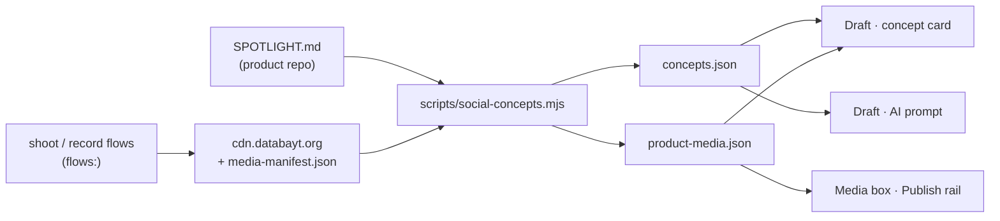

A **spotlight** is a `SPOTLIGHT.md` file that sits next to a feature's code and explains the
feature to people who do not read code: the copywriters drafting a post about it and the media
team filming it. Engineering detail stays in the `README.md` beside it. The spotlight says what
the feature does for a school, who it is for, what you can claim about it, what you must not
claim, and which real screens show it.

Every feature a brand sells should have one. Today that is the school product: hogwarts has 53
spotlights, and all twelve features in `content/social/features.json` resolve to one. mkan, souq
and the other products have none yet. See [adding spotlights to another product](#adding-spotlights-to-another-product).

## Where the social block uses it



| Section of the spotlight | Where it shows up |
| --- | --- |
| **In one line** | The concept card's headline on Draft, and the first fact in the AI prompt |
| **The school's day without it** · **What happens** | The card's *Read more*, and the prompt's "what happens" (capped so one long note cannot crowd out the brief) |
| **What you can say** · **Do not say** | The card, and the prompt — the AI is told both lists |
| **Post angles** | Ideas for the writer; the calendar plan's angles come from the same notes |
| **Real screens to show** + `flows:` | The card's *Real screens* strip, the Publish rail's recommended media, and the Media box |
| `status: partial` | A note on the card: keep to what the note says you can say |
| `routes:` | What the media team films when a feature has no screens yet. The card prints the routes and the shoot command |

The card and the prompt read vendored JSON, because a production build of kun has no sibling
repos and the Worker has no filesystem. **Re-run the extractor after editing a spotlight or
publishing new screens**, then commit what it wrote:

```bash
node scripts/social-concepts.mjs        # kun — writes content/social/{concepts,product-media,voice}.json
```

It prints the coverage and every gap: a feature with no spotlight, or a spotlight with no screens,
each with the shoot command that fills it.

## The file

```markdown
---
feature: attendance
title: Attendance
status: partial                      # live | partial
pillar: school-operations
personas: [teacher, principal, registrar, parent, student]
routes: [/ar/s/{school}/attendance, /ar/s/{school}/attendance/reports]
screenshots: []                      # legacy repo-local captures; prefer flows
flows: [mark-attendance]             # shoot/record flows whose screens show this feature
readme: ./README.md
docs: content/docs-en/attendance.mdx
updated: 2026-10-18
---
```

Then ten sections, in this order, with these exact headings (the extractor finds them by name):

1. **In one line.** One sentence a parent would understand.
2. **The school's day without it.** The paper, the phone calls, the waiting.
3. **What happens in Balqalam.** Numbered steps, as someone would live them.
4. **Who it is for.** One bullet per persona: what changes for them.
5. **Real screens to show.** Starts with the generated CDN block (below), then notes on what to capture next.
6. **What you can say.** Each claim cites its source in brackets: a file, a doc section, a screenshot.
7. **Do not say.** Everything tempting and untrue: unbuilt features, regulator claims, numbers, banned words.
8. **Post angles.** `"Hook" — persona — pillar — the scene or the screen`.
9. **Connects to.** The neighbouring features.
10. **Sources.** The files the note was written from.

A copy to start from: `content/social/SPOTLIGHT.template.md`.

### Rules

- **Plain words.** No component names, no table names, no "API".
- **Every claim has a source.** A claim with no file or doc behind it goes under *Do not say*.
- **The banned list wins.** Offline, native app, AI predictions, hours saved, percentages and
  regulator submission stay out of *What you can say* even if code for them exists
  (`content/docs/social/balqalam.mdx` → Claims).
- **No real student faces or names** without written consent. The demo tenant's names are fine.

## Real screens: spotlight, shoot and the CDN

A spotlight never embeds a screenshot. It names the **flows** that film the feature, and the
screens come from wherever those flows published:

1. A flow is a file in `kun/.claude/skills/shoot/flows/<repo>/<verb>-<entity>.mjs`. It declares
   `route`, `block`, `paths`, `title` and `alt`. A read-only page tour is three lines on top of
   `_tour.mjs`.
2. `shoot.mjs --flow <name> --lang ar,en --publish` films it on the demo tenant and publishes to
   `cdn.databayt.org/hogwarts/<lang>/<route>/<step>.avif|webp`. `/record` does the same for video.
   Each asset lands in hogwarts' `src/components/docs/media-manifest.json`.
3. Add the flow name to the spotlight's `flows:` and run `node scripts/spotlight-cdn.mjs` in
   hogwarts. It rewrites the block between `<!-- cdn:start -->` and `<!-- cdn:end -->` under
   *Real screens to show* with links anyone can open.
4. Run `node scripts/social-concepts.mjs` in kun and commit. The screens now appear on the Draft
   card, the Publish rail and the Media box for that feature.

| Feature | Flows | Screens |
| --- | --- | --- |
| admission | manage-admission | 7 |
| attendance | mark-attendance | 1 |
| exams | create-exam | 4 |
| grades | enter-grades | 4 |
| timetable | view-timetable | 4 |
| finance · fees | set-fees | 2 |
| parent-portal | parent-portal | 1 |
| transportation | track-transport | 2 |
| messaging | send-message | 1 |
| reports | view-reports | 1 |
| documents | view-documents | 2 |

Counts are Arabic screens; each has an English twin. Screens belong to the **balqalam** brand only.
The shipped app introduces itself as بالقلم, and the brand kit forbids that name on a
hogwarts-brand asset.

## Adding spotlights to another product

1. Write `SPOTLIGHT.md` next to each feature the brand sells (the ids in `features.json`), from
   the template.
2. Give the product a flow folder under `shoot/flows/<repo>/` and a media manifest, as hogwarts has.
3. Add the product to the extractor's sources and its brand to `SCHOOL_BRANDS` / `SCREEN_BRANDS`
   in `src/lib/social-concept.ts`. Until then its concept card says there is no note yet, and the
   AI drafts from the brief alone.
